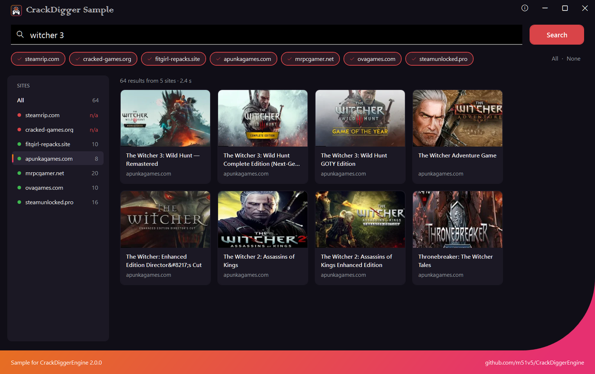

<div align="center">

# CrackDiggerEngine

**Search game listings on several public game sites from .NET.**

[](https://www.nuget.org/packages/CrackDiggerEngine)
[](https://www.nuget.org/packages/CrackDiggerEngine)
[](LICENSE)
[](https://github.com/m51v5/CrackDiggerEngine/actions/workflows/ci.yml)

© 2025–present · [@m51v5](https://github.com/m51v5) · [m51v5.com](https://m51v5.com)

</div>

---

CrackDiggerEngine is a .NET library that searches game listing sites for a keyword and returns each result's title, link and image. Search one site, a few, or all of them at once.

## Features

- **Several sites, one API:** pick a site from an enum, or search them all.
- **Clean results:** every result has a title, a link and an image address, never `null`.
- **Errors as data:** a site that fails returns `isSuccess = false` and an `ErrorMessage`, so one broken site doesn't stop the others.
- **Ready for JSON:** map results to dictionaries in one call.
- **Light:** one dependency, HtmlAgilityPack.

---

## Install

```
dotnet add package CrackDiggerEngine
```

Needs .NET 8 or newer. Package page: [nuget.org/packages/CrackDiggerEngine](https://www.nuget.org/packages/CrackDiggerEngine).

---

## Quick start

```csharp
using CrackDigger;

var result = await CrackDiggerEngine.FindGameAsync(CrackDiggerEngine.enSiteUri.ovaGamesDotCom, "witcher 3");

if (result.isSuccess)
{
    foreach (var game in result.Data!)
    {
        Console.WriteLine($"{game.Title}: {game.GameLink}");
    }
}
else
{
    Console.WriteLine($"Error: {result.ErrorMessage}");
}
```

Search every site at once:

```csharp
var all = await CrackDiggerEngine.FindGameAllSitesAsync("witcher 3");

foreach (var (site, games) in all)
{
    Console.WriteLine($"{site}: {(games.isSuccess ? games.Data!.Count() + " results" : games.ErrorMessage)}");
}
```

---

## Supported sites

| Enum value | Site | Status (2026-11-15) |
|---|---|---|
| `fitgirl_repacksDoteSite` | fitgirl-repacks.site | ✅ Works |
| `apunkagamesDotCom` | aapunkagames.com | ✅ Works. The site moved from apunkagames.com; the enum name stays |
| `mrpcgamerDotNet` | mrpcgamer.net | ✅ Works |
| `ovaGamesDotCom` | ovagames.com | ✅ Works |
| `cracked_gamesDotOrg` | cracked-games.org | ✅ Works |
| `steamUnlockedDotPro` | steamunlocked.pro | ❌ The site's own search doesn't work: it answers with its home page, so the result is `isSuccess = false` with "site search not available" |
| `steamripDotCom` | steamrip.com | ❌ Blocked by the site's bot protection |

`CrackDiggerEngine.getSuporttedSites` returns the same list as a dictionary of enum value to domain.

**How sites are searched:** for sites that run WordPress, the library asks the site's [WordPress REST API](https://developer.wordpress.org/rest-api/) for posts whose title matches, so a change to the site's theme doesn't break it. If the API is off, it reads the site's search page instead. Other sites are always read from their search page. Titles come with HTML entities decoded, and links and images as absolute addresses.

---

## API

All members are on the static class `CrackDiggerEngine`, in the `CrackDigger` namespace.

### Search

| Method | Returns |
|---|---|
| `FindGameAsync(enSiteUri site, string keyword)` | `Task<clsGames>`: one site's results |
| `FindGameFilteredSitesAsync(List<enSiteUri> sites, string keyword)` | `Task<Dictionary<enSiteUri, clsGames>>`: the listed sites, each searched once |
| `FindGameAllSitesAsync(string keyword)` | `Task<Dictionary<enSiteUri, clsGames>>`: every supported site |

Sites are searched one after another. Each search sends one request to that site, or two when its WordPress API fails and the search page is tried next.

### HTTP client

All searches share one `HttpClient`.

| Member | What it's for |
|---|---|
| `HttpClient` | The client in use. Change its headers or `Timeout` directly |
| `UseHttpClient(HttpClient client)` | Use your own client from now on, for a proxy, a custom handler or tests. The library never disposes it, and adds its User-Agent only if yours has none |
| `UserAgent` | The User-Agent the library sends |

```csharp
var handler = new HttpClientHandler { Proxy = new System.Net.WebProxy("http://127.0.0.1:8080") };
CrackDiggerEngine.UseHttpClient(new HttpClient(handler) { Timeout = TimeSpan.FromSeconds(15) });
```

### Results

**`clsGames`**, one site's search:

| Property | Meaning |
|---|---|
| `isSuccess` | `true` if the search worked. Through the WordPress API, `Data` can be empty when nothing matched |
| `ErrorMessage` | Why it failed, when `isSuccess` is `false` |
| `SearchLink` | The site's own search page for the keyword, to open in a browser |
| `SiteUrl` | The site's domain |
| `Data` | The results, as `IEnumerable<clsGameDataObject>`; `null` when it failed |

**`clsGameDataObject`**, one result: `Title`, `GameLink`, `ImageLink`. Each is an empty string when the site didn't provide it.

Both classes are created by the library only.

### Mapping

| Method | Returns |
|---|---|
| `MapAllGamesDataAsync(IEnumerable<clsGameDataObject> data)` | `Task<IEnumerable<Dictionary<string, string>>>` |
| `MapSingleGameDataAsync(clsGameDataObject data)` | `Task<Dictionary<string, string>>` |

Each dictionary has the keys `title`, `link` and `image`:

```csharp
var rows = await CrackDiggerEngine.MapAllGamesDataAsync(result.Data!);
string json = System.Text.Json.JsonSerializer.Serialize(rows);
```

---

## Privacy

Each search sends one or two requests to that site, its WordPress API and then its search page if needed, with your keyword in the address and a User-Agent naming the library. Nothing goes anywhere else, and nothing is saved. Results come from third-party pages, so treat them as untrusted input. Details are in [SECURITY.md](SECURITY.md).

---

## Sample app

A Windows app in [`samples/CrackDigger.Sample`](samples/CrackDigger.Sample) that shows the library at work: it searches the sites you pick at the same time, and shows each site's status and the results as cards. Build it from source; it isn't released.

```
dotnet run --project samples/CrackDigger.Sample
```



**Privacy and updates:** besides the searches, the sample downloads each result's cover image, and on launch it asks GitHub for the latest release to tell you when a newer library is out. It never downloads or installs anything. Details are in [SECURITY.md](SECURITY.md).

---

## Documentation

- [Development guide](docs/DEVELOPMENT.md): building, checks, the sample app, adding or fixing a site, and publishing a release.

---

## Build from source

You need the [.NET 8 SDK](https://dotnet.microsoft.com/download/dotnet/8.0).

```
git clone https://github.com/m51v5/CrackDiggerEngine.git
cd CrackDiggerEngine
dotnet build CrackDiggerEngine.sln
```

---

## Notes

- **Moving from `CrackDiggerEngineByM51V5`:** that package ID is deprecated. Run `dotnet remove package CrackDiggerEngineByM51V5`, then `dotnet add package CrackDiggerEngine`, and change `using CrackDiggerEngineByM51V5;` to `using CrackDigger;`. Class and method names are the same.
- Sites change their pages without notice, so a site can stop working between releases. Check `isSuccess` and `ErrorMessage` on every result.

---

## Disclaimer

This library works like a search engine: it shows only information that the sites make public. It doesn't claim ownership of that information, which belongs to its owners. It stores nothing and isn't meant to be used against intellectual property or DRM rules.

---

## Contributing and support

- Found a bug, a broken site, or have an idea? [Open an issue](https://github.com/m51v5/CrackDiggerEngine/issues/new/choose).
- Want to help? Read the [contributing guide](CONTRIBUTING.md) and the [code of conduct](https://github.com/m51v5/.github/blob/main/CODE_OF_CONDUCT.md).
- Found a security problem? See [SECURITY.md](SECURITY.md).
- Other ways to reach me: [m51v5.com/contact](https://m51v5.com/contact).

---

## License

[MIT](LICENSE) © [@m51v5](https://m51v5.com)
